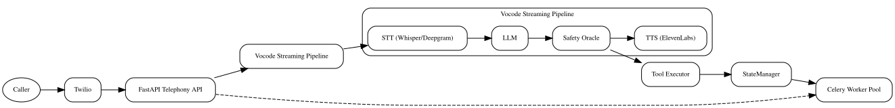

# TEL3SIS – Telephony‑Linked Embedded LLM System 

> **Codename:** TEL3SIS  
> A real‑time, voice‑first, agentic platform built on top of **vocode‑python** to answer incoming phone calls, hold natural LLM‑powered conversations, use external tools (Google Calendar, Weather, SMS, Email), record & transcribe audio, and hand off to a human seamlessly.

---

## ✨ Key Features

| Capability | Status | Notes |
|------------|--------|-------|
| Real‑time STT ↔️ LLM ↔️ TTS loop | ✅ Phase 1 | Whisper / Deepgram + GPT‑4o + ElevenLabs |
| Call recording & transcription | ✅ Phase 1 | Audio in `recordings/audio`, transcripts in `recordings/transcripts` |
| Toolchain via OpenAI Function Calling | 🔄 Phase 2 | Weather, Google Calendar, SMS/email |
| Context‑aware call forwarding | 🔄 Phase 3 | Whisper summary piped to human |
| Tri‑layer memory (Redis + SQLite + Vectors) | 🔄 Phase 4 | Session ↔ Mid‑term ↔ Long‑term |
| Safety oracle (pre‑execution) | 🔄 Phase 5 | Red‑team simulation + audit logs |
| Dashboard / metrics | 🛠 Phase 6 | Prometheus + Grafana |
| CI / CD & DevSecOps | 🛠 Continuous | Git‑secrets, pytest, pre‑commit |

---

## 🏗️ High‑Level Architecture




---

## 📂 Directory Layout (Phase 0 – 1)

```
TEL3SIS/
├── agents/               # Core & tool‑aware agent configs
├── server/
│   ├── app.py            # FastAPI entrypoint
│   ├── celery_app.py     # Celery factory
│   └── state_manager.py  # Redis wrapper
├── tools/                # Calendar, Weather, SMS, etc.
├── scripts/              # Dev helpers and startup tasks
├── admin-ui/             # React dashboard (optional)
├── tasks.yml             # Swarm task manifest
├── docker-compose.yml
├── Dockerfile
├── requirements.txt
└── README.md
```

---

## 🚀 Quick‑Start (Development)

**Prerequisites:** Git, Docker (+ Docker Compose), and [ngrok](https://ngrok.com) must be installed locally.

1. **Clone & enter repo**

   ```bash
   git clone https://github.com/yourname/TEL3SIS.git
   cd TEL3SIS
   ```

2. **Install Python dependencies**

   ```bash
   pip install -r requirements.txt
   ```
   ```bash
   pre-commit install
   ```
   Install git hooks so `pre-commit` runs automatically.
3. **Create `.env`**

   ```bash
   cp .env.example .env
   # ➜ populate Twilio, OpenAI, ElevenLabs, Deepgram, EMBEDDING_PROVIDER, EMBEDDING_MODEL_NAME, etc.
   ```

4. **Launch stack**

   ```bash
   docker compose up --build
   ```

5. **Expose to Twilio**

   ```bash
   ngrok http 3000
   # copy https URL ➜ Twilio Console ➜ Voice Webhook = https://xxxx.ngrok.io/inbound_call
   ```

6. **Call your Twilio number** – if TEL3SIS answers, Phase 1 is alive.

7. **Open Grafana**

   Visit [http://localhost:3001/d/tel3sis-latency](http://localhost:3001/d/tel3sis-latency) (default login `admin`/`admin`).
   If the dashboard is missing, import `ops/grafana/tel3sis.json` via **Dashboard → Import**.

8. **Launch the React admin UI** (optional)

   ```bash
   cd admin-ui
   npm install
   npm run dev
   ```

### React Admin UI

Open [http://localhost:5173](http://localhost:5173) to use the dashboard. The React app talks to the FastAPI backend on port 3000.

## 📑 API Reference

Detailed examples for every `/v1` endpoint can be found in [docs/api_usage.md](docs/api_usage.md).

---
**Local (non‑Docker) setup**  
```bash
python -m venv venv
source venv/bin/activate
pip install -r requirements.txt
uvicorn server.app:create_app --factory --reload
```
> Use this only for lightweight debugging; Docker remains the canonical environment.

---

## ⚙️ Environment Variables

| Key | Description |
|-----|-------------|
| `BASE_URL` | Public URL for webhook (ngrok / k8s ingress) |
| `TWILIO_ACCOUNT_SID` / `TWILIO_AUTH_TOKEN` | Twilio credentials for SMS and escalation |
| `OPENAI_API_KEY` | LLM access |
| `ELEVEN_LABS_API_KEY` | TTS voice |
| `EMBEDDING_PROVIDER` | `openai` or `sentence_transformers` |
| `EMBEDDING_MODEL_NAME` | SentenceTransformers model name or path |
| `OPENAI_EMBEDDING_MODEL` | Model name when using OpenAI embeddings |
| `REDIS_URL` | Redis connection for state & Celery broker |
| `CELERY_BROKER_URL` | Broker URL for Celery |
| `CELERY_RESULT_BACKEND` | Result backend for Celery |
| `DATABASE_URL` | SQLite / Postgres for mid‑term memory |
| `ESCALATION_PHONE_NUMBER` | Phone number used when handing off calls |
| `TWILIO_PHONE_NUMBER` | Default caller ID for outbound SMS and calls |
| `TOKEN_ENCRYPTION_KEY` | Base64 AES key for encrypting OAuth tokens |
| `GOOGLE_CLIENT_ID` / `GOOGLE_CLIENT_SECRET` | OAuth credentials for Calendar |
| `SENDGRID_API_KEY` | SendGrid API key for email notifications |
| `SENDGRID_FROM_EMAIL` | Sender email address for SendGrid |
| `NOTIFY_EMAIL` | Recipient for call transcripts |
| _see `.env.example`_ |

### Generating and Storing the Encryption Key

The `TOKEN_ENCRYPTION_KEY` must be a persistent 128‑bit AES key encoded in
base64. Generate one using:

```bash
python - <<'EOF'
import base64, os
print(base64.b64encode(os.urandom(16)).decode())
EOF
```

Add the resulting value to your `.env` file under `TOKEN_ENCRYPTION_KEY` before
starting the server. The decoded key must be exactly 16 bytes (AES‑128).
Example:

```bash
TOKEN_ENCRYPTION_KEY="$(python - <<'EOF'
import base64, os
print(base64.b64encode(os.urandom(16)).decode())
EOF
)"
```

Without this key, TEL3SIS will refuse to launch.

---

## 🛠️ Development Workflow

| Phase | Lead Tasks | Branch Tag |
|-------|------------|------------|
| **0 Init** | `INIT-00` → `INIT-04` | `init/` |
| **1 Core** | `CORE-01` → `CORE-06` + `OPS-01` | `core-mvp/` |
| **2 Tools** | `MEM-01`, `TOOL-01`–`05`, `OPS-02` | `tools/` |
| **3 Handoff** | `FWD-01`–`04` | `handoff/` |
| **4 Memory** | `MEM-02`, `MEM-03`, `QA-01` | `memory/` |
| **5 Safety** | `SAFE-01`–`03`, `SEC-01` | `safety/` |
| **6 UI/Ops** | `MON-01`, `UI-01`–`03` | `ui-ops/` |

Use feature branches named `<phase>/<task_id>-short-desc`, then open a PR referencing the task ID in **`tasks.yml`**.

---

## 🧪 Testing

```bash
pytest -q
```

* Unit tests live under `tests/`
* End‑to‑end call emulation via `tel3sis dev-call`
* STT latency reduction via `tel3sis warmup`
* Management commands via `tel3sis manage`


### Management CLI

#### User Management Commands

```bash
tel3sis manage create-user alice secret --role admin
tel3sis manage list-users
tel3sis manage update-user alice --password newpass --role user
tel3sis manage delete-user alice
```

#### System Maintenance

```bash
tel3sis manage generate-api-key alice
tel3sis manage migrate
tel3sis manage cleanup --days 30
```

### Maintenance Commands

Create and restore backups using the CLI after installing the package with
`pip install -e .`:

```bash
# create a backup and upload to S3
tel3sis backup --s3

# restore from an archive
tel3sis restore backups/latest.tar.gz
```

---

## 📊 Monitoring

* **Prometheus** scraps `/metrics` exposed by the FastAPI app
* Alert rules live in `ops/prometheus/*_rules.yml` and define when latency is too high
  or HTTP errors spike
* Alerts trigger if STT/LLM/TTS average latency stays above **3 s** for over a minute
* Alertmanager reads `ops/prometheus/alertmanager.yml` and posts to Slack via `SLACK_WEBHOOK_URL`
  or PagerDuty via `PAGERDUTY_ROUTING_KEY` in `.env`
* Browse Grafana at [http://localhost:3001/d/tel3sis-latency](http://localhost:3001/d/tel3sis-latency).
  Import `ops/grafana/tel3sis.json` if the dashboard isn't present to see latency and task metrics.

---

## 🔐 Security

* All secrets loaded from `.env` (never committed)
* `git-secrets` pre‑commit hook blocks accidental key leaks
* OAuth tokens are AES‑GCM encrypted via `cryptography` before storage
* Safety Oracle filters any risky LLM output before TTS

---

## 🖇️ Tool Plugins (Phase 2)

| Tool | Trigger Example | Implementation |
|------|-----------------|----------------|
| **Weather** | “What’s the weather tomorrow?” | OpenWeatherMap REST |
| **Calendar** | “Book a meeting at 10 AM” | Google Calendar API + OAuth |
| **SMS/Email** | “Text me the transcript” | Twilio Messages / SendGrid |
| **Browser** | “Open example.com” | Browser Use library |

_Add new tool by implementing `tools/<name>.py` and registering JSON schema in `agents/tools_registry.py`._

### Notifications

Transcripts can be sent automatically once SendGrid and Twilio credentials are configured. Set:

- `SENDGRID_API_KEY` and `SENDGRID_FROM_EMAIL` – enables `send_email()`
- `NOTIFY_EMAIL` – default email recipient
- `TWILIO_ACCOUNT_SID` and `TWILIO_AUTH_TOKEN` – enables `send_sms()`
- `TWILIO_PHONE_NUMBER` – caller ID for outbound messages
- `ESCALATION_PHONE_NUMBER` – destination for escalation SMS

If these variables are unset, the system logs a warning and skips the notification.

---

## 📚 Reviews

- [Build, Test & Deploy Review](reviews/build_test_deploy_review.md)
- [Build, Test & Deployment Review](reviews/build_test_deployment_review.md)
- [Interfaces & Interactions Review](reviews/interfaces_interactions_review.md)
- [Core Logic Architecture Review](reviews/core_logic_architecture_review.md)

---

## 🤝 Contributing

1. Fork & clone
2. Check open issues in **`tasks.yml`**
3. Branch ➜ code ➜ `pytest` ➜ PR
4. PR must pass CI + receive one approval
5. Install the hooks described in [CONTRIBUTING.md](../CONTRIBUTING.md)

We follow the **Conventional Commits** spec.

---

## 📜 License

MIT. See `LICENSE`.

---

> Crafted with ♥ by **Adrian Wedd** & the TEL3SIS Swarm. Contributions welcome!